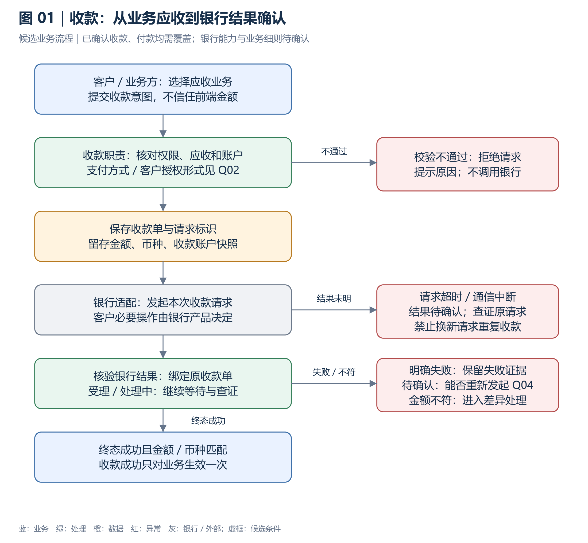
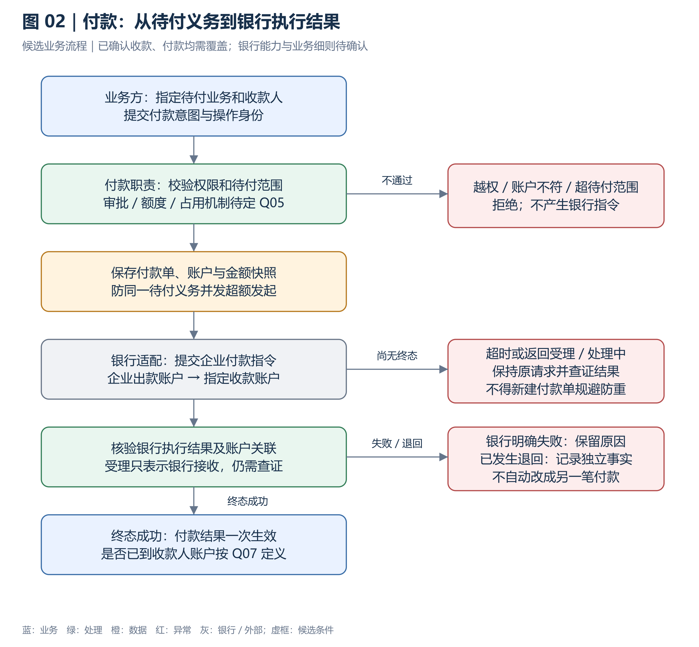
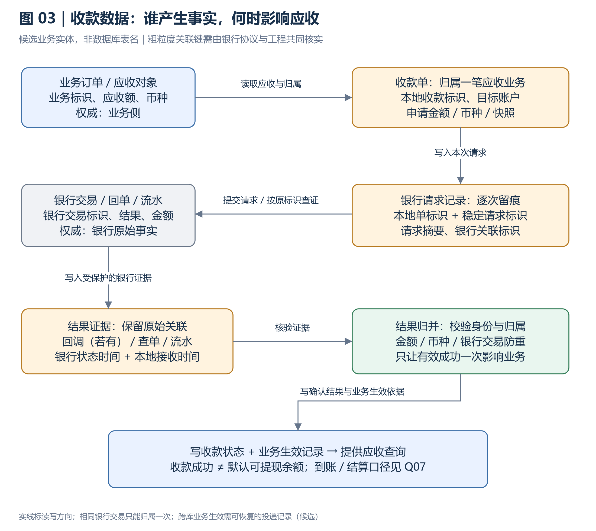
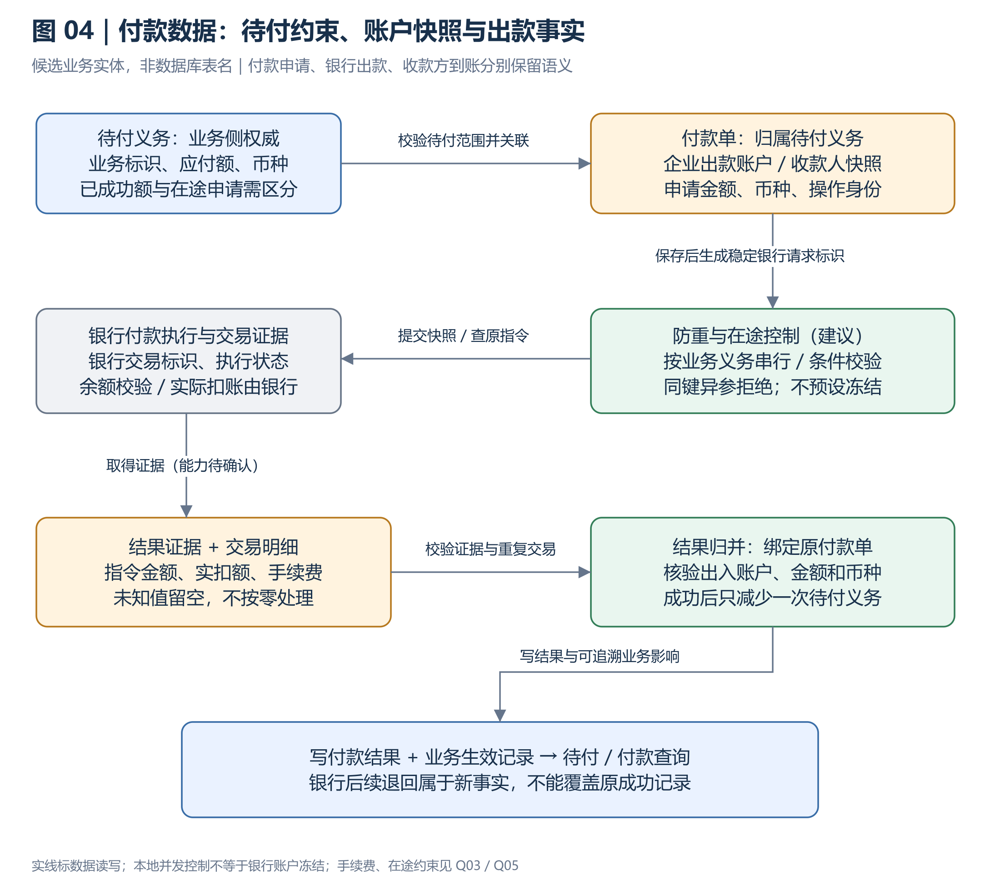
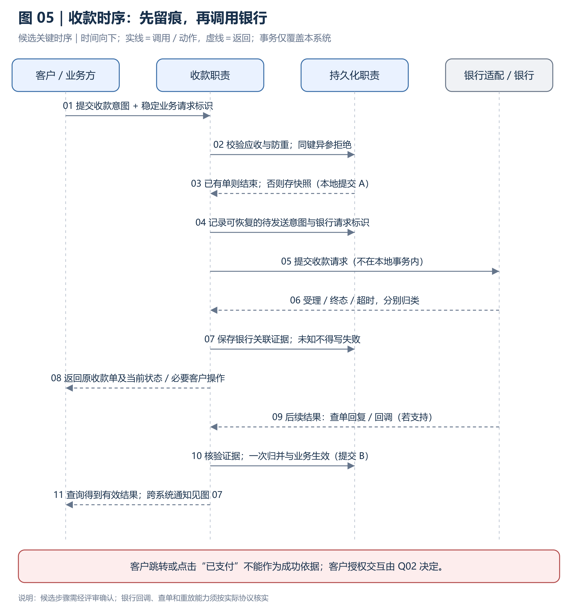
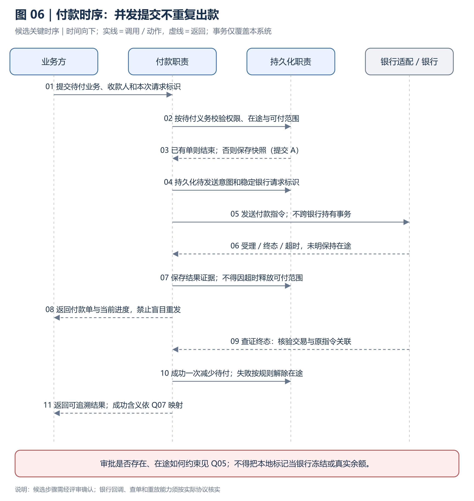
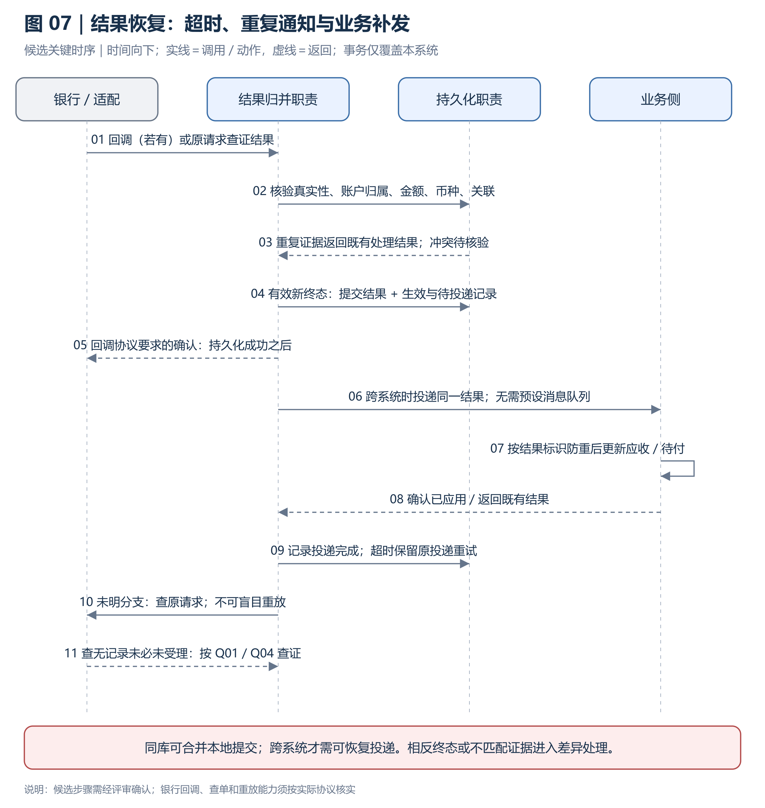
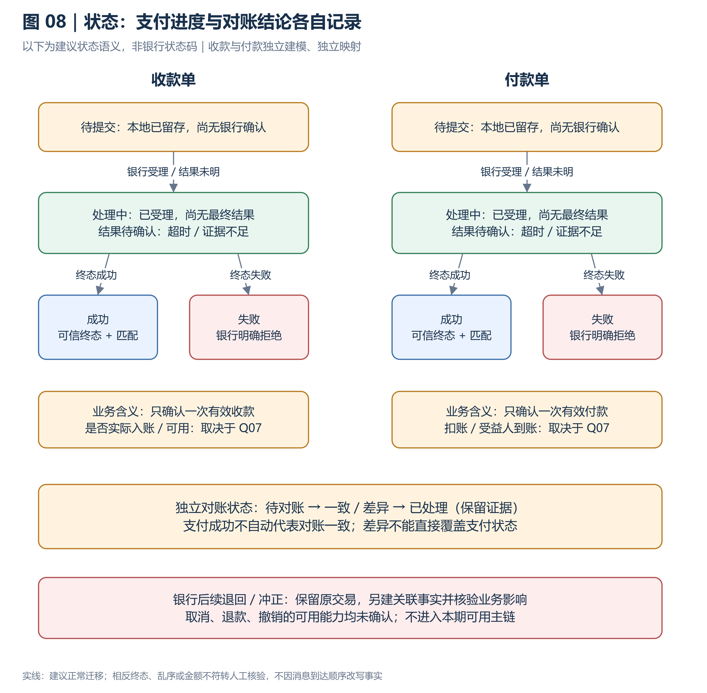
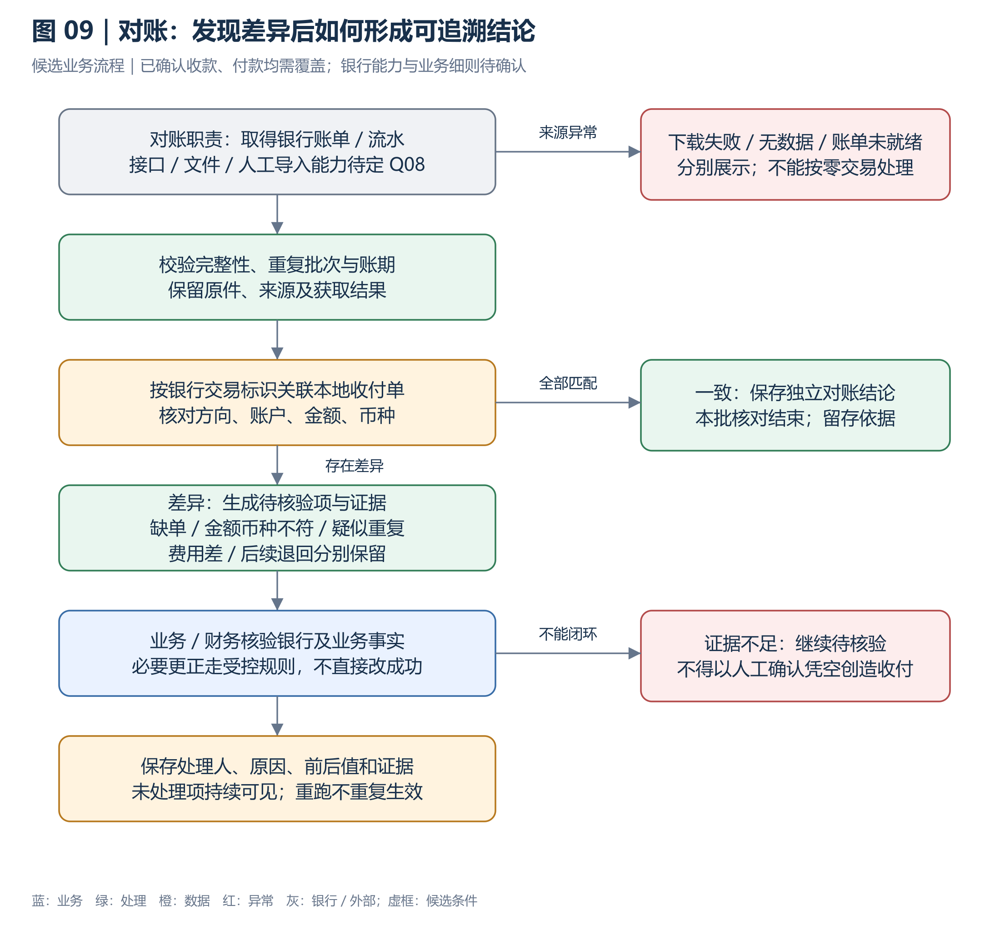
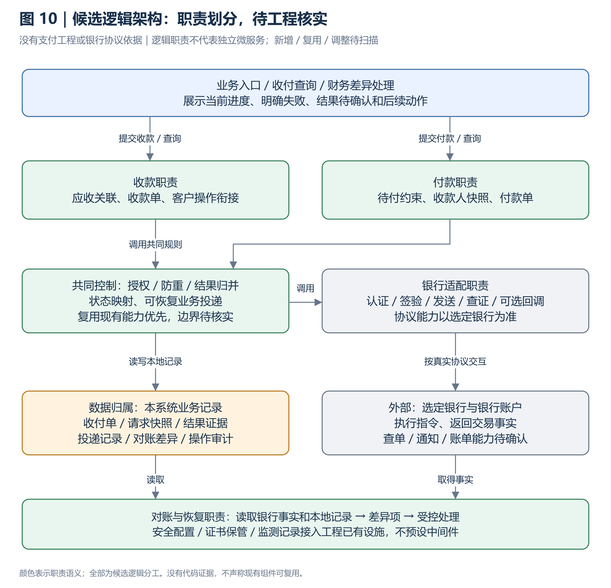

# PRD-Killer

**把零散需求和长篇 PRD，整理成开发者看图就能理解的交接稿。**

PRD-Killer 是一套面向产品与研发协作的 AI Skill：用业务流程、数据流转、关键时序和技术架构讲清“做什么、数据怎么走、异常怎么办”，再配上独立接口契约和可勾选开发清单。

源码位于 [Skills-Share/PRD-Killer](https://github.com/BerLin-Justin/Skills-Share/tree/main/PRD-Killer)。

适合 PRD 梳理、跨角色业务评审和研发交接，也支持从一句尚不完整的需求开始：先整理确定部分，将建议与待确认规则直接标在相关图中。

**先看效果：**[银行收付款示例](#银行收付款示例) · **开始使用：**[快速开始](#快速开始) · **了解交付：**[交付内容](#交付内容) · **维护项目：**[渲染与维护](#渲染与维护)

## 银行收付款示例

### 从一句需求开始

```text
使用 prd-killer 帮我梳理一条调用银行接口的支付链路。
收款和付款都需要，以 Markdown 格式交付到我指定的目录。
```

这句话确认了“接入银行、同时包含收款与付款”，但没有提供银行、产品、工程代码或接口协议。因此，本例输出的是 **V0.1 讨论稿**：分别展开收付链路，把超时查证、防重和对账作为建议基线，将账户主体、客户授权、审批、费用及退款范围保留为待确认。示例不代表银行能力已经核实，也不代表代码已实现。

### 查看完整产物

| 文档 | 打开后能看到什么 |
| --- | --- |
| [银行收付款需求图解](references/需求图解.md) | 收款与付款分别建模；业务、数据、时序、架构及状态和对账；统一规则、待确认项与验收设计 |
| [关键接口契约草案](references/关键接口契约.md) | 发起收付、银行提交、查证、条件回调、业务结果投递、查询及差异核验的输入输出与失败处理 |
| [开发顺序清单](references/开发顺序清单.md) | 14 项任务及依赖、完成条件和依据；没有实现证据，全部保持未勾选 |

本例有 **10 张图、9 类关键调用、14 项开发任务**，数量由链路复杂度决定，其他需求按实际范围裁剪。图示为离线生成的 PNG，并保留同名 SVG 与 `diagrams/source/` 原生 SVG 源。

### 预览：业务流程

收款先核对应收和账户，再以银行可信结果确认业务生效；超时进入“结果待确认”，避免重新发起造成重复收款。



<details>
<summary>展开付款流程：企业出款、待付范围与未知结果</summary>

付款要核对企业出款账户、收款人和待付范围。同一业务的不同请求也要防并发超付，银行受理不直接展示成受益人已到账。



</details>

### 预览：数据、时序与架构

<details>
<summary>数据流转：谁产生申请，谁提供银行事实，何时影响业务</summary>

收付申请、银行结果证据与业务生效记录分别表达；账户、金额、币种和关联标识贯穿主链，申请金额不冒充实际到账金额。





</details>

<details>
<summary>关键时序：本地先留痕，银行结果归并，业务影响只生效一次</summary>

先保存意图再调用银行；外部调用不圈进本地事务。超时查原请求，重复通知与重复业务投递都不能重复影响应收或待付。







</details>

<details>
<summary>状态与对账：受理、成功、到账和对账一致分别表示什么</summary>

支付进度与对账结论独立记录。旧处理中通知不能让终态回退；后续退回或冲正保留为关联事实，不覆盖原交易证据。





</details>

<details>
<summary>候选逻辑架构：收付职责、共同控制、银行适配与数据归属</summary>

没有工程代码时，仅展示候选逻辑职责，不预设微服务、缓存或消息队列。真实新增、复用和调整点留待工程核实。



</details>

这组示例演示的是分析与交接方式，不是通用银行业务规则。接入具体银行时，必须使用真实产品协议重新确认状态、授权、重放安全性和到账含义。

当前写作示例统一使用上方三份银行收付款文档，集中存放在 `references/`；配图与可编辑源放在 `assets/bank-payment-example/diagrams/`。分析、契约和任务清单沿用同一组规则与问题编号。

## 快速开始

### 1. 安装 Skill

需要 **Node.js 22 或更高版本**和 npm。在下载或克隆的项目根目录执行：

```bash
git clone https://github.com/BerLin-Justin/Skills-Share.git
cd Skills-Share/PRD-Killer
npm ci
npm start -- --help
npm run skill:install
```

默认安装到 `CODEX_HOME/skills/prd-killer`；未设置 `CODEX_HOME` 时使用 `~/.codex/skills/prd-killer`。在 Windows 上，通常对应当前用户目录下的 `.codex/skills/prd-killer`。

其他支持 Skill 的客户端，可以指定它使用的完整 Skill 目录：

```bash
npm run skill:install -- --target "../prd-killer-installed"
```

**自定义目标必须位于本项目目录之外，也不能是包含本项目的父目录。** 安装器会拒绝与包源重叠的路径，因此不要从源码根目录安装到 `./output/skills/prd-killer`。目标目录已经存在时也会拒绝覆盖；升级先备份个人修改，再选新的目标目录安装。

### 2. 在 AI 客户端发起需求分析

将 PRD 正文、截图、文档或工程位置交给支持 Skill 的 AI 客户端，再提出请求：

```text
请使用 prd-killer 梳理这份需求，面向研发交接。
先核实材料和工程依据，以业务流程、数据流转、时序和架构图为主。
已确认、建议、待确认要区分；没有依据的银行规则和接口不要补造。
交付需求图解、适用的关键接口契约和可勾选开发顺序清单，
以 Markdown 保存到：<你的输出目录>。
```

提供的材料越完整，交接越能贴近实际实现。只有一句需求也可以先出讨论稿；补齐银行文档、业务结论或代码后，再更新受影响部分并保留原编号和已有进度。

### 3. 阅读并确认交付

先用主图核对业务链路、金额和状态，再看待确认问题会阻塞哪些工作。接口如何调用看独立契约；开发先后和完成条件看清单。图示与文档完成后，业务确认、代码实现、银行联调和上线验收仍需分别进行。

## 交付内容

| 产物 | 用途 | 生成条件 |
| --- | --- | --- |
| `需求图解.md` | 讲清业务流程、数据流转、关键时序、候选／实际架构及关键决策 | 按需求范围交付；小改动按需选图 |
| `关键接口契约.md` | 讲清调用职责、输入输出、权限、失败及防重要求 | 涉及关键调用或接口变更时；无协议或工程依据标需求级草案 |
| `开发顺序清单.md` | 按依赖列出可勾选任务、完成条件、关联依据及阻塞 | 面向研发的 PRD 梳理默认交付；用户限制范围时遵从 |
| `diagrams/` | 可直接阅读的 PNG、配套 SVG 与可编辑源 | 主文用相对路径引用，不依赖阅读器解析 Mermaid |

典型目录如下，文件命名可跟随业务和版本调整：

```text
输出目录/
├─ 需求图解.md
├─ 关键接口契约.md
├─ 开发顺序清单.md
└─ diagrams/
   ├─ 01-business.png
   ├─ 01-business.svg
   └─ source/
      └─ 01-business.dot 或 01-business.svg
```

正文用图说明“做什么与为什么”，契约说明“怎么对接”，清单说明“先做什么及怎样算完成”。三份文档相互链接，共用同一套规则和问题编号；清单不塞进分析或契约的附录。

## 能力与使用边界

| 情况 | 如何处理 |
| --- | --- |
| PRD 长、来源分散或多角色协作 | 先理清对象、金额、状态、责任和异常，再按独立业务链拆图 |
| 有工程代码 | 先读 `AGENTS.md`，核对相似实现、接口与数据归属，注明复用、调整及新增 |
| 没有代码或银行协议 | 使用候选逻辑架构和需求级契约，不编造数据库表名、HTTP 路径、字段类型或错误码 |
| 规则缺失或互相冲突 | 继续整理确定部分，在影响结果的分支标待确认及其影响，不代替业务方定规则 |
| 小查询改动、纯翻译或单字段解释 | 按实际范围处理，不硬凑四类图或三份文档 |
| 缺少渲染工具 | 优先使用已有本地能力；仍无法渲染则明确交付未渲染源稿及缺失项 |

AI 客户端负责读取 [SKILL.md](SKILL.md)、理解材料并执行分析；npm CLI 负责安装资源和渲染 DOT。文件、在线文档及浏览器能否读取，由客户端已有能力和授权决定。CLI 本身不调用模型，也不独立解析 DOCX 或生成完整 PRD。

## 渲染与维护

### 渲染 DOT 图示

安装依赖后，在源码根目录执行：

```bash
npm run render -- --input "./assets/small-query-example/diagrams/source/ticket-filter.dot" --output "./output/diagrams" --width 1800
```

常用参数：

| 参数 | 含义 |
| --- | --- |
| `--input` | 单个 `.dot` 文件或仅扫描一层 `.dot` 的目录 |
| `--output` | 同名 SVG 和 PNG 的输出目录 |
| `--width` | PNG 宽度，范围 400—4800，默认 1800 |
| `--overwrite` | 允许重绘并覆盖指定输出目录中的同名图；默认拒绝覆盖 |
| `--module-dir` | 复用外部已安装依赖的 `node_modules` 目录 |

渲染器使用 `@viz-js/viz` 和 `sharp`；依赖就绪后可本地运行，不上传业务材料。中文需要可用的系统字体，脚本使用 Microsoft YaHei 及系统回退。生成后仍应打开图片检查中文、字号、连线和截断。

**本次银行示例保留的是原生 SVG 源，不能直接交给只接收 DOT 的 CLI。** 原生 SVG、Mermaid 等来源按 [渲染说明](references/rendering.md) 选用现有工具；无需为展示示例重新渲染。

### 本地测试与打包

```bash
npm test
npm run pack:check
npm pack
```

测试针对安装目录保护、参数转发及中文渲染、无效输入、默认不覆盖等关键边界；目录链接测试依赖环境允许创建 junction 或符号链接。文档和示例更新优先核对相对链接、配图和规则一致性；涉及 CLI 或渲染行为时再执行对应验证。

打包配置包含 Skill 规则、参考、示例资产、图源和 CLI；`node_modules`、生成的 tarball 及 `output` 不进入发布包，依赖由 `package-lock.json` 固定。**重新打包后，更新的 README 和示例才会进入新的包产物；现有 `prd-killer-0.1.0.tgz` 不会随源码修改自动更新。**

### npm 发布前后如何使用

源码方式不要求 npm 已发布。发布前生成本地 tarball 后，可验证包入口和安装：

```bash
npm exec --yes --package "./prd-killer-0.1.0.tgz" -- prd-killer --version
npm exec --yes --package "./prd-killer-0.1.0.tgz" -- prd-killer install --target "../prd-killer-package-smoke"
```

以下命令仅适用于维护者已经将**本项目**以对应包名、版本发布到 npm 的情况；当前源码版本是 `0.1.0`，本说明不代表 npm 已发布：

```bash
npx --yes prd-killer@0.1.0 install
npx --yes prd-killer@0.1.0 install --target "../prd-killer-installed"
npx --yes prd-killer@0.1.0 render --input "./diagrams/source" --output "./diagrams"
```

也可以在确认包来源后安装为全局命令：

```bash
npm install --global prd-killer@0.1.0
prd-killer --help
```

没有 `postinstall` 自动复制行为，只有显式执行 `install` 子命令才安装 Skill 资源。仓库地址及 `PRD-Killer` 子目录已配置在 `package.json`；发布 npm 前仍需核实包名、维护者身份及许可证，当前配置为 `UNLICENSED`。需要发布时，由维护者登录并执行：

```bash
npm login
npm publish --access public
```

本地修改、测试和打包均不代表已上传 GitHub 或发布 npm。

## 项目导航

```text
PRD-Killer/
├─ README.md                  项目首页、使用说明与案例展示
├─ SKILL.md                   AI 读取的分析与交付规则
├─ package.json               运行要求、依赖、命令及打包配置
├─ bin/prd-killer.mjs          install / render CLI
├─ scripts/render-diagrams.mjs 本地 DOT 渲染器
├─ references/                分析规范与三份银行收付款示例
├─ assets/
│  ├─ bank-payment-example/    银行收付款的 10 张图与可编辑源
│  ├─ small-query-example/     DOT 渲染回归夹具
│  └─ visual-example/          历史渲染回归图源
├─ agents/openai.yaml         Skill 展示信息与默认提示
└─ evals/                     行为案例、夹具及关键测试
```

项目说明统一维护在 `README.md`，安装与打包沿用该入口；三份示例随 `references/`、配图随 `assets/` 一同携带。业务示例仅作分析方法参考，不将示例规则直接套到其他项目。
