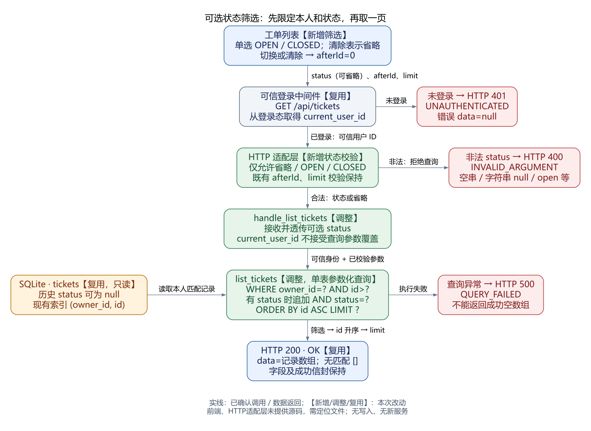

# 本人工单查询：新增可选状态筛选

用户可直接筛选 OPEN／CLOSED，不再逐页翻找。本次只调整既有列表查询；保留本人权限、游标分页、历史数据和响应结构。

配套：[关键接口契约](example-confirmed-contract.md) · [开发顺序清单（可勾选）](example-confirmed-checklist.md)。本文件保留改动图、业务规则与验收，协议字段和失败响应、执行任务分别在配套文档维护。

**要改哪里，数据怎样经过筛选再分页？**

- **新增交互与校验：**单选状态；切换或清除时 `afterId=0`。`status` 省略表示不筛选，历史 `null` 仍可返回；仅接受大小写完全一致的 `OPEN`、`CLOSED`。空串、字符串 `null`、`open` 等均拒绝，不自动纠正。
- **复用查询链：**调整 `ticket_query.py` 的 `handle_list_tickets` 透传末尾新增可选参数，`list_tickets` 仅在提供合法状态时追加参数化 `AND status = ?`。本人范围、状态、游标在同一查询的 `WHERE` 生效，之后才排序并取页；禁止查一页后再过滤。
- **权限与性能：**`current_user_id` 继续来自可信登录中间件，查询参数不能覆盖。仍是单表查询，先保留现有 `(owner_id, id)` 索引；开发时用代表数据检查有／无状态两条路径的执行计划、扫描量与 IO，再决定是否需新增索引。当前无性能结论。

**关键验收（待开发执行）：**准备本人含 OPEN／CLOSED／null 及他人工单的交错ID样本；省略状态应含本人 null，指定状态只能返回本人匹配记录；匹配记录落在未筛选首20条之后仍应返回，且按 `id` 升序、`id > afterId` 继续翻页；切换/清除状态从0开始；非法状态、未登录和查询异常分别命中约定错误。

依据：夹具 `context.md`（SRC-001～003）、`ticket_query.py`、`schema.sql`，均为脱敏练习材料。Python／SQLite、方法名与现有索引已静态核对；前端与 HTTP 适配层源码未提供，实现前需定位文件。未修改夹具，未实现功能、运行数据库／接口／前端验证或编译；图已离线生成并做视觉检查。不增加导出、批量更新、审批、通知或数据库迁移，不承诺上线日期。

练习依据：[上下文](../evals/fixtures/ticket-query/context.md)、[查询代码](../evals/fixtures/ticket-query/ticket_query.py)、[结构与索引](../evals/fixtures/ticket-query/schema.sql)。
