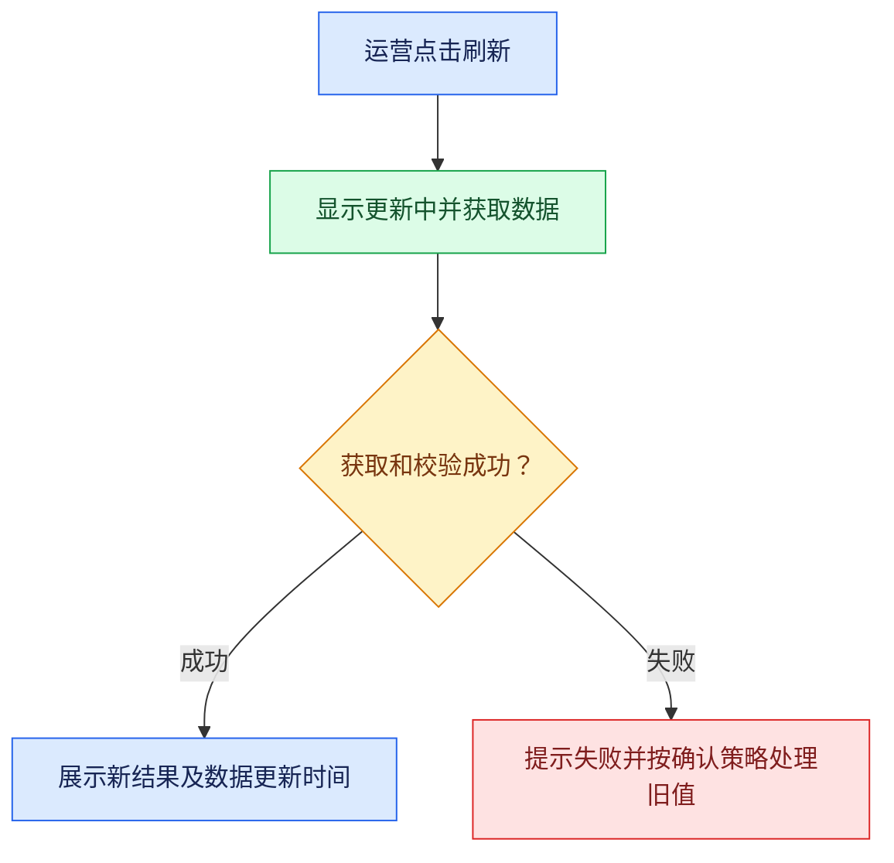

# 候选分析示例：让运营看懂日报刷新

> 历史内容示例：只借鉴来源区分、候选边界和精确验收，不沿用长文排版。新版按 output-template.md 输出图解，正文不再重复完整故事。本文件仅展示分析内容；涉及调用时，按 api-contract.md 另交关键接口契约。

演示输入：运营经常向研发询问日报是否更新，希望自己查看和刷新。只有截图文字转录“业务日期、处理单量、更新时间、刷新按钮”，原文要求“最新、秒级可用、100%准确、失败提示”。没有原图、接口、代码、容量或团队信息。本例是合成写作参考，不是用户实际项目的复测结果。

## 1. 背景与痛点

运营查看日报时，不知道数据是否已经更新，经常需要研发帮助确认。本次希望让运营自行刷新，并从页面知道数据对应的日期、更新情况和失败结果，减少来回查证。

现有刷新方式与后台能力尚未核实。转录能支持页面字段和按钮的描述，不能证明已有同步接口可以直接复用，也不能据此认定一定要新建服务。

## 2. 具体业务场景

运营打开日报，先查看业务日期、处理单量和更新时间。需要确认最新结果时点击刷新，页面显示正在更新，后台尝试取得该日期的新结果。只有取数和必要校验成功后，才一起更新数量和对应的数据更新时间，避免用户把旧结果误认为新结果。

以下采用候选失败策略：如果更新失败，页面提示失败并允许重试；业务允许时保留相同业务日期上次成功的结果及原更新时间。如果首次就失败，没有历史结果，则显示暂未获取，不能把失败当成零单。旧数据是否允许展示，需要产品确认。

多人刷新、连续点击或请求返回顺序不同，也不能让较早结果覆盖较新结果。具体版本依据和重复处理方式在技术部分说明。上述文字已经交代主线与异常，下图辅助看清分支。

## 3. 需求目标与范围

本期保留四项明示要求：自行查看与刷新、秒级可用、结果准确、刷新失败提示。“秒级”和“准确”需要先明确可测量的含义，不能从方案里删除，也不能直接写成已具备的能力。

新增报表、导出、消息通知和历史重算没有输入依据，暂不扩入本期。若刷新必须依赖重新同步或计算，这部分需要纳入实际工作量，而非只估一个按钮。

## 4. 业务逻辑与规则

业务日期决定统计哪一天，日期时区待明确；处理单量应说明哪些业务对象计入、何时算完成、重复/补录/撤销如何处理。“更新时间”建议表示数据截至或源端更新时间，而非用页面读取时间冒充；来源无法提供时标明未知。

成功更新应展示同一日期和同一统计截面的完整结果；更新中与成功分开表达。失败提示和旧值展示沿第二节的候选策略，产品确认后再作为最终规则。

当前重要问题：数据负责人需明确权威来源与统计口径，影响取数、去重和准确性验收；产品需明确旧值与刷新目标，影响交互和失败处理；研发需核查刷新是否已有接口、是否重新同步，影响架构复用和排期。

## 5. 架构方案

候选职责分为页面、查询与刷新入口、数据获取与校验、权威数据源。页面负责交互和结果呈现；入口负责身份与数据范围、组织处理及错误返回；获取模块负责按已确认口径取数、核对结果。它们可以位于现有应用中，不代表必须拆成独立服务。

目前没有工程证据，以下仅展示候选逻辑关系。拿到可靠接口说明或代码后，先检查现有链路和可复用边界。

## 6. 技术选型与实现方案

先核实数据是否已形成可读取结果。如果来源能在目标时限内返回一致结果，优先评估直接读取，开发与运行链路较短；如果必须重新同步或计算，则比较后台处理和进度查询方案，任务受理成功不能等同数据已经更新。

前端按当前业务日期和请求标识匹配响应；来源有数据版本或时间时进一步比较，避免较旧业务结果覆盖较新结果，不能只用请求先后证明数据更“新”。涉及持久化同步时，按来源稳定业务标识与批次/版本判断重复，再按确认规则合并或替换；标识、补录和覆盖语义未定时不能声称已经解决去重。

失败时检查是否已经取得或保存有效结果，再决定查询、重试或人工处理；不能重复写入，也不能把部分失败伪装为完整成功。若采用跨系统调用，需说明超时和结果查证，不能只依赖本地事务。

缓存、队列和新增存储是否需要取决于容量、时延及处理方式。相关开发、调用、存储和维护成本待工程核查后估算。查询关注日期/权限过滤、执行计划和 IO，尚未验证性能，不给具体产品或预算作既定承诺。

## 7. 任务拆解与排期

先核查数据源、口径、权限和已有链路，再确定直接读取或重新处理；之后完成后端处理、前端状态和关键边界验证。契约明确后前后端可以并行，联调在两端就绪后进行。

目前缺数据规模、人员投入和现有实现，先列这些交付物及依赖，暂不承诺总人日或上线日。若需要新增同步链路，应明确增加的任务；刷新失败提示不能从范围里漏掉。日期、成本或复用条件明确后，再估相关工作量。

## 8. 验收标准

选取包含重复、补录或撤销情形的已知样本，按第四节确认的来源、统计口径与同一时间截面对账，检查显示日期、数量和更新时间是否对应，不能只验“页面有数字”。

刷新成功时，检查页面从更新中转为成功并展示新结果；模拟来源超时，检查失败提示。业务确认允许保留旧值后，再验证原日期数据与原更新时间保留；无历史数据时显示暂未获取。连续点击和乱序响应不能回退到较旧结果，同时验证越权请求被拒绝。

“秒级可用”分别定义查询耗时与数据更新延迟的起止事件、负载范围、统计方法和目标，明确未达标时的提示或处理。没有这些口径前只能列验证计划，不能承诺“秒级”和“100%”。本例未执行任何运行或性能验证；后续用实际日报案例复核可读性和准确性。
