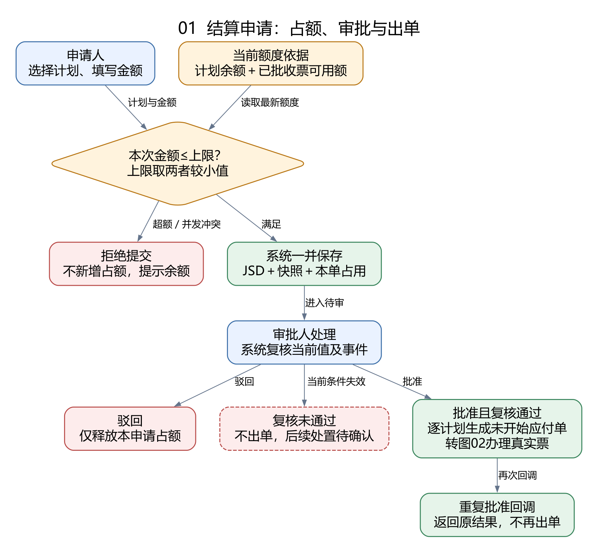
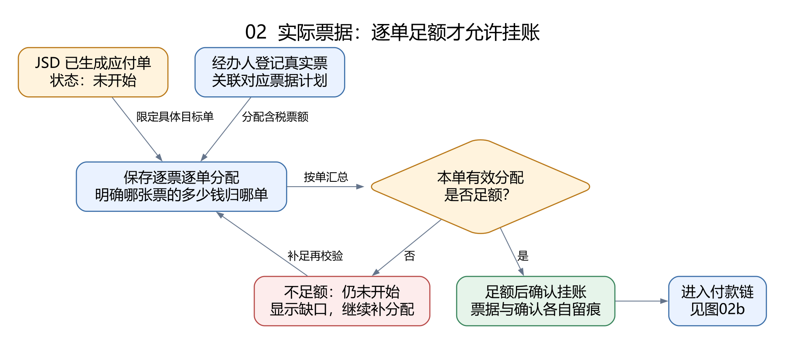
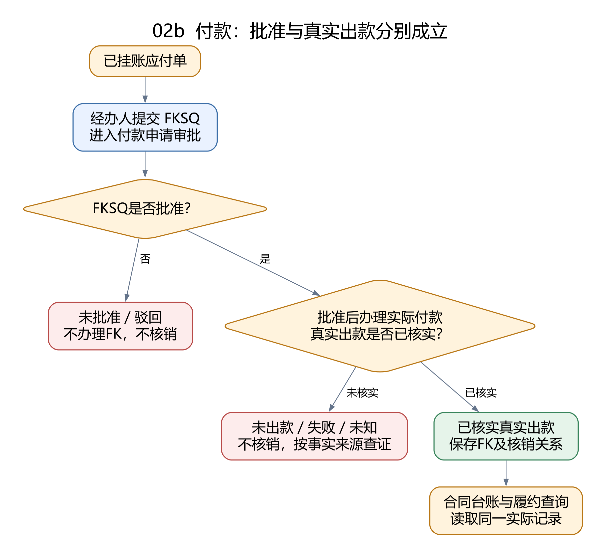
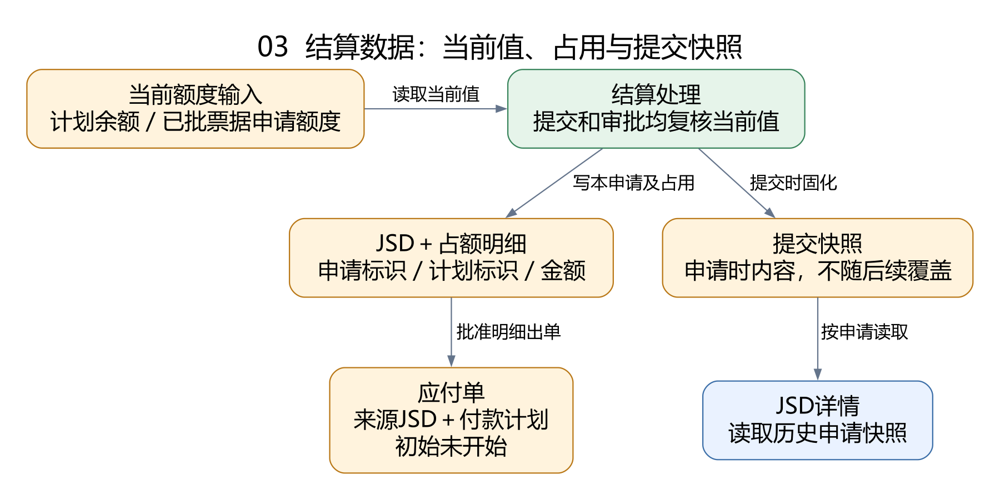
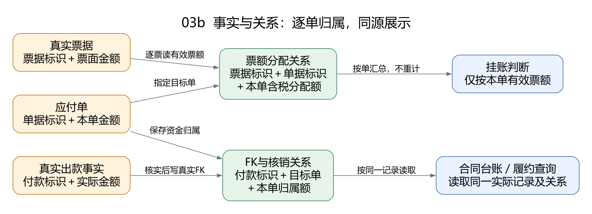
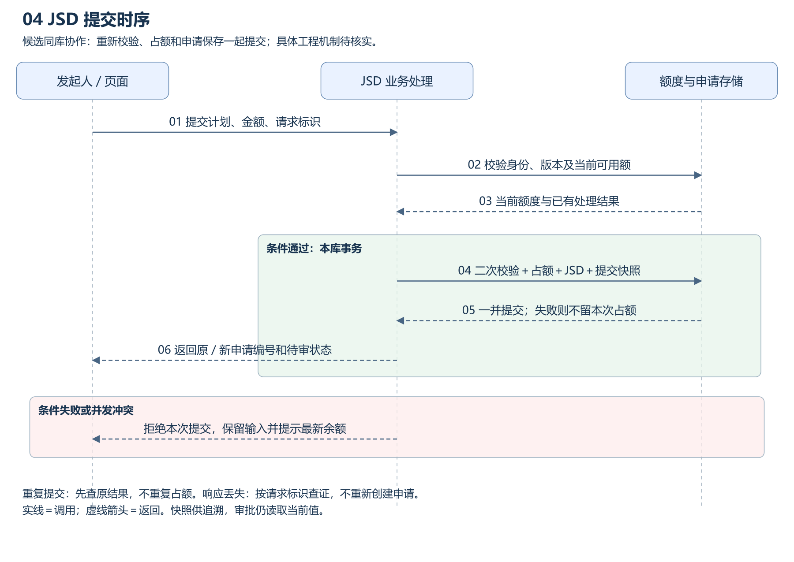
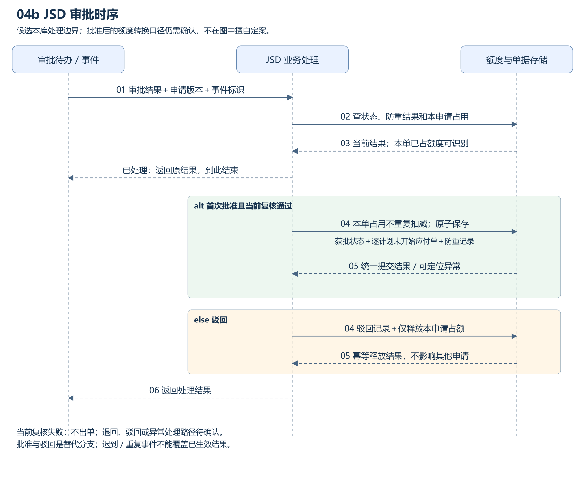
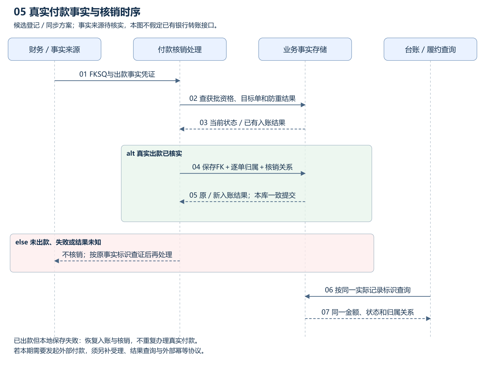
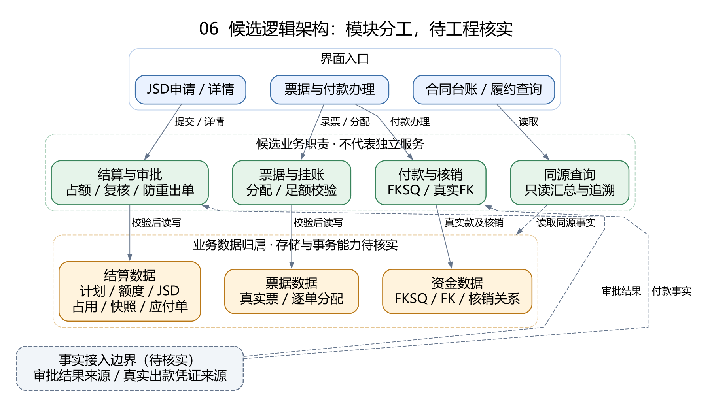

# 图解交接示例 结算与付款

本次把 JSD（结算申请）、FKSQ（付款申请）和实际 FK（付款）的边界分开：**占额不等于挂账，批准不等于出款，真实出款才核销**。manual 付款计划示例为 **10 万元**。材料只有需求，没有工程代码；下列技术机制均为候选设计，不能认定为已有能力。

本示例只演示图解分析稿；完整研发交接涉及关键调用时，还须按 [接口契约](api-contract.md) 独立生成配套文档，图中必要数据语义不替代契约字段。

## 业务流程

**JSD 什么时候占额、出应付单和释放？**

- 常规结算上限取 `min(计划余额, 已批准收票申请可用额度)`；10 万元是计划总额示例，不代表任何时点都可结算 10 万元。
- 提交详情保留当时快照；审批必须复核当前数据。本申请已占额度不能在复核时被重复扣减。
- 驳回仅释放本 JSD 占额。批准后占额如何转已用、何时影响余额，尚需业务确认；不得擅自当作“批准即释放”。

**什么时候挂账，什么时候才能核销？**

- 真实票必须分配到具体应付单；不能以“收票申请已批准”代替真实票，也不能用汇总足额掩盖某张应付单缺票。
- FKSQ 批准只放行实际 FK 办理；未出款、出款失败或结果不明时，都不能据审批结果核销。
- FKSQ 驳回不发生实际 FK。其是否另占付款额度、是否需要释放，与 JSD 占额不能混用，需另行确认。

## 数据流转

**哪些是当前依据、历史快照和真实业务事实？**

- 图中为业务实体与语义关联，不是数据库表或字段。应付单必须可追溯到 JSD 和付款计划；真实票分配必须保留逐单金额。
- 快照用于回看提交时看到的内容；当前值用于复核。两者分开标识，不能覆盖快照或用快照判断当前可用额度。
- 合同台账与履约查询按同一实际记录读取，不各自生成一份事实；实际记录的字段范围及历史兼容待工程核实。

## 关键时序

**并发提交、重复回调、驳回怎么保持金额与单据一致？**

- 图中“原子提交”表示相关修改一起成功或一起失败；具体事务实现待工程确认。并发校验要约束同一额度归属，不能只先查询再无条件扣减。
- 候选出单唯一范围为“JSD＋付款计划”；重复批准事件返回已有结果。批准事件和驳回事件冲突时先核对当前状态，不能让迟到事件改写已处理结果。
- 提交失败不得留下本次新占额；丢失响应先查原申请。审批复核不通过时不出单，退回还是驳回仍待确认。

**真实付款结果如何查证，为什么不能重复落账？**

- 图示为登记／同步已发生出款的候选协作，不假定已有银行接口。若本期还需发起外部付款，应另补外部协议和结果查证；不能把外部付款圈进本地核销事务。
- 已确认出款但本地落账失败时，恢复记录与核销处理；不能重新付款。结果不明先查证，核销处理也须避免重复。

## 技术架构

**这些规则落在哪些职责，哪里需要工程证据？**

- 逻辑模块用于划清职责，不代表微服务或部署拆分；数据库、语言、消息设施、外部付款渠道均未指定。
- 工程接入先找相似实现，核实哪些可复用、哪些需调整。暂无代码，不能声称已验证接口、索引、IO 或事务能力。

## 开发改动与关键决策

| 改动落点 | 必须达到的结果 |
| --- | --- |
| JSD 与额度处理 | 当前校验、提交占额、详情快照、审批当前复核、逐计划幂等出单、只释放本申请 |
| 票据与挂账 | 保留逐单分配关系；单张应付单真实票不足额时阻止挂账 |
| FKSQ、实际 FK 与核销 | 先批准后办理；真实出款才核销；相同事实不重复入账、核销 |
| 合同台账与履约查询 | 共同追溯同一实际业务记录 |

开工前优先确认三组口径：① 计划余额与收票可用额的归属范围、扣减项及批准后的占额转换时点；② 足额金额口径、票的重复分配限制及 FKSQ／核销对应应付单的粒度；③ 当前复核失败后的审批处置、真实出款证据来源与结果查证方式。以上不改变已确定的主链，但影响额度计算和落账实现。

## 附录 关键验收场景（待开发后执行）

| 前置与动作 | 可观察结果 |
| --- | --- |
| 示例计划余额 10 万，已批准收票可用额 6 万；提交 7 万 | 常规结算被阻止，本次不留占额；6 万为本验收构造的数据 |
| 两个 JSD 并发争用同一不足以覆盖双方的额度 | 成功占额总和不突破可用额度；失败方无残留占额 |
| 提交后当前数据变化；审批查看旧快照 | 详情仍可回看快照，审批使用当前数据复核 |
| 相同 JSD 的批准回调重复到达 | 每个付款计划只保留应生成的一张未开始应付单 |
| 同计划有两个 JSD 占额，仅其中一个被驳回 | 仅释放被驳回申请占额，另一个保留 |
| 一张应付单缺真实票，但其他单分配有余 | 缺票单不能挂账；汇总金额不替代逐单检查 |
| FKSQ 批准但实际 FK 未真实出款 | 不核销；丢响应先查证，不能凭批准状态认定出款 |
| 已真实出款，重复结果或核销失败后恢复 | 同一出款不重复支付／核销；两个查询入口追溯同一实际记录 |

本例为合成演示，不能替代完整原PRD的规则评审。图源保留在 `../assets/visual-example/diagrams/source/`，SVG 与 PNG 同名配套；本稿仅完成需求与图示交付，未实施或运行上述业务验收。
