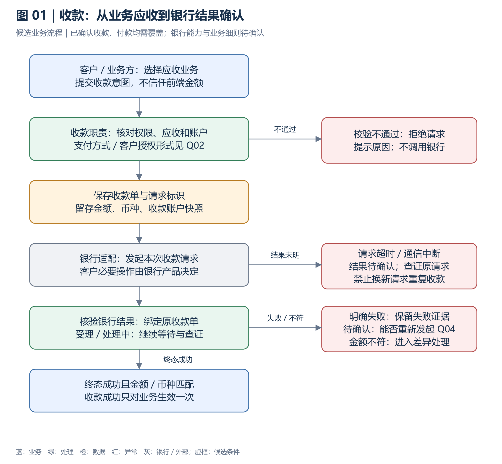
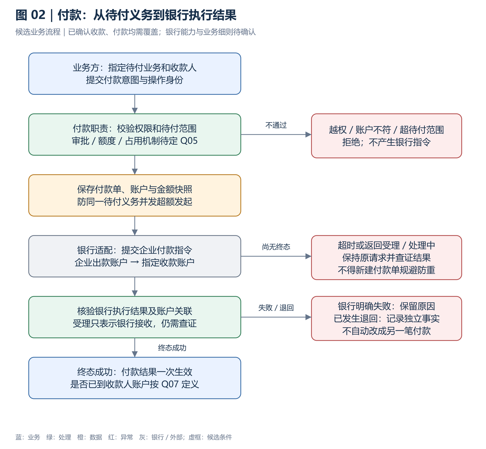
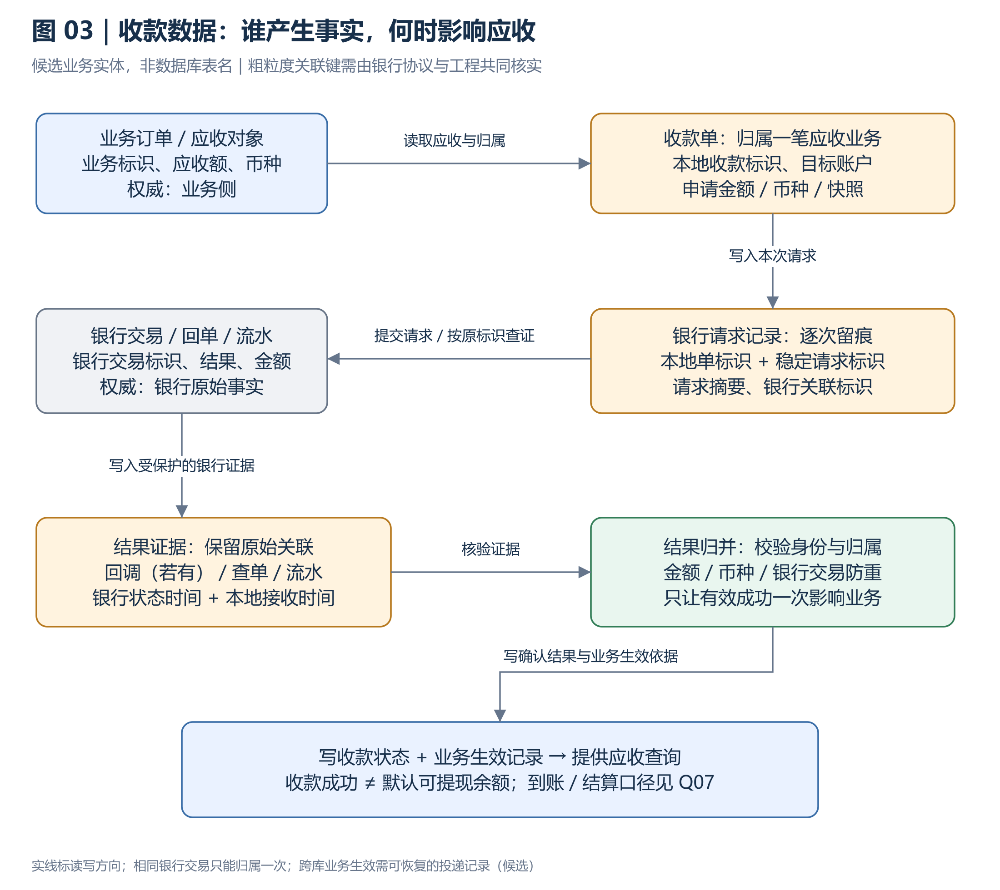
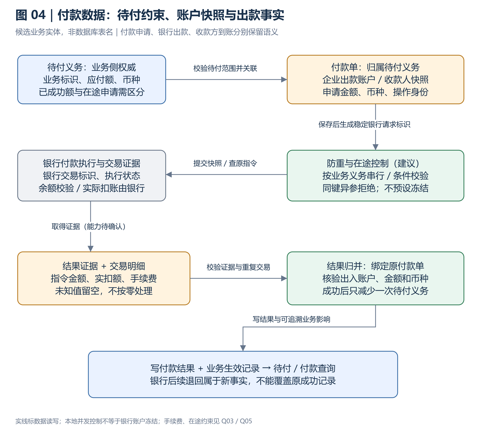
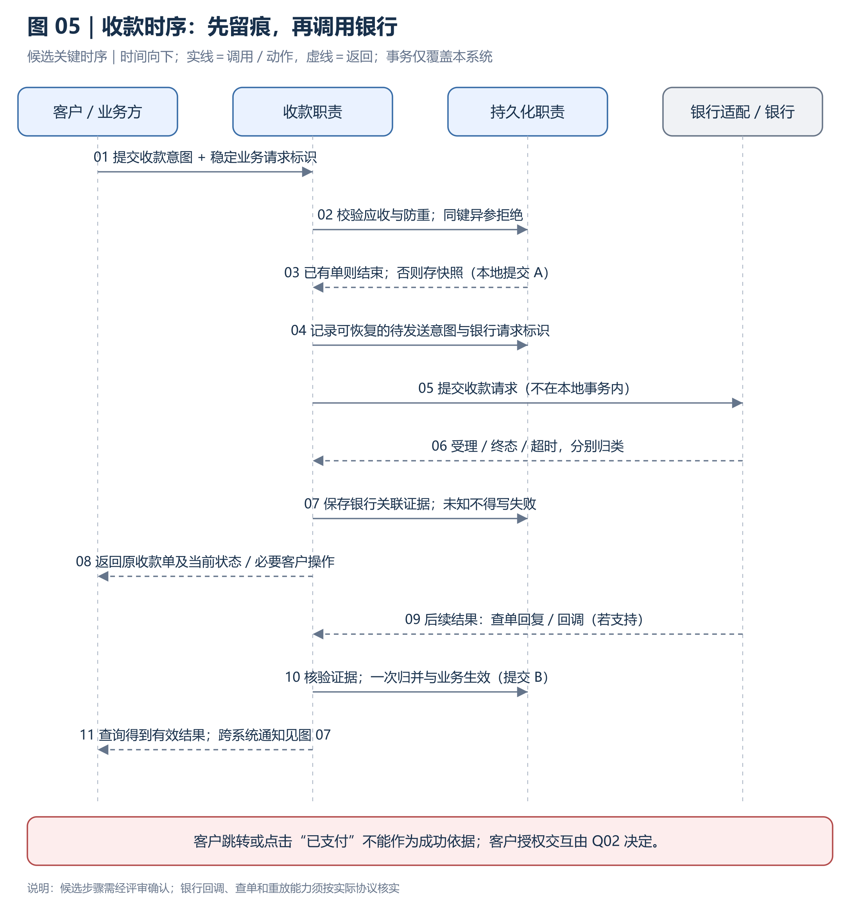
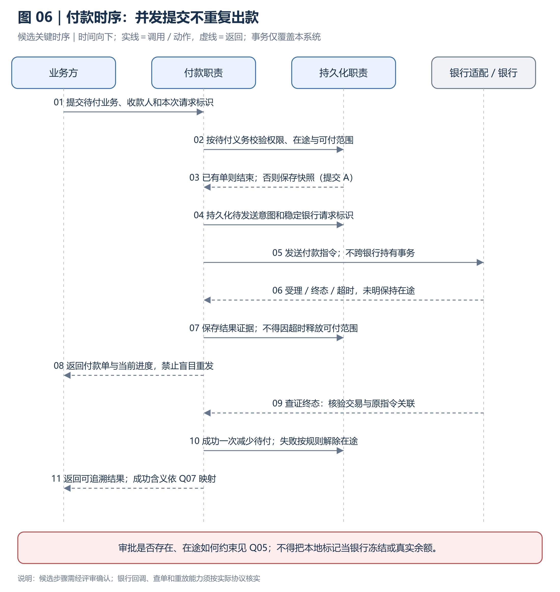
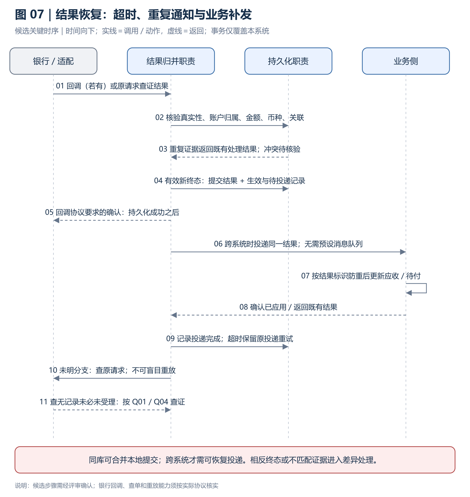
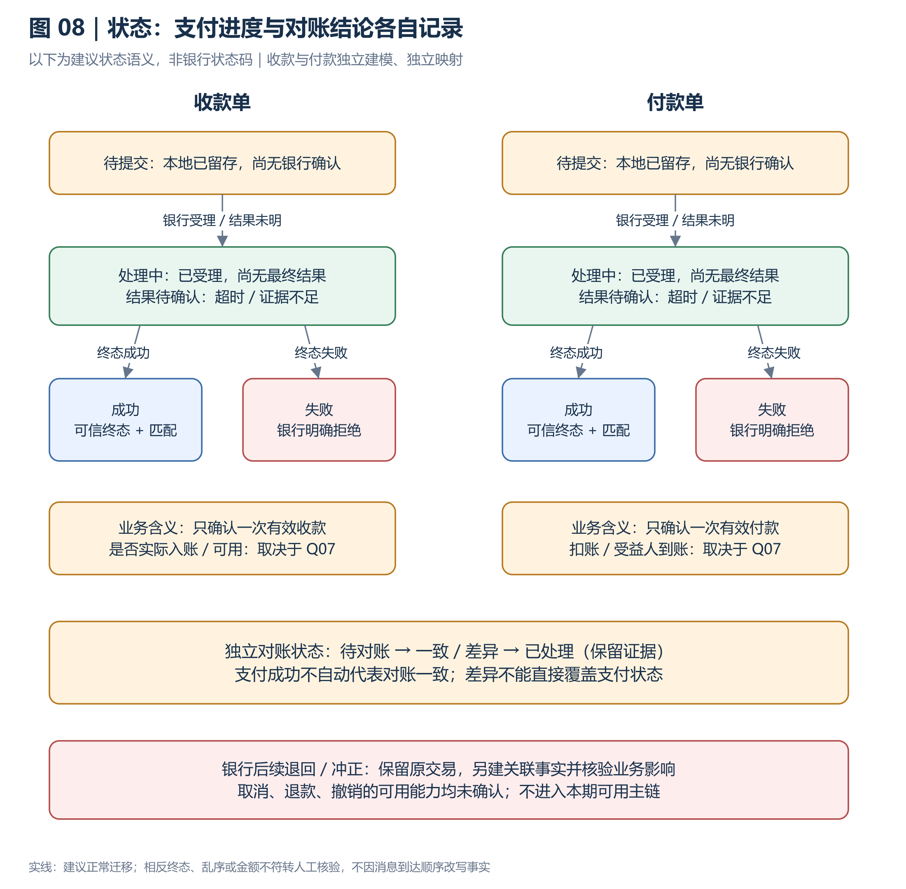
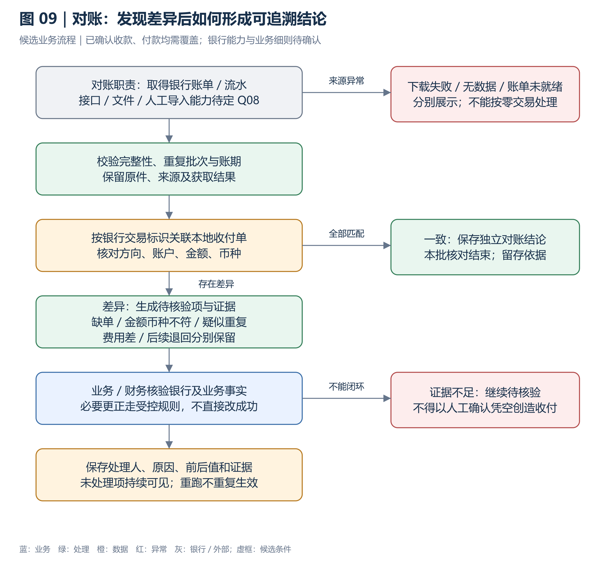
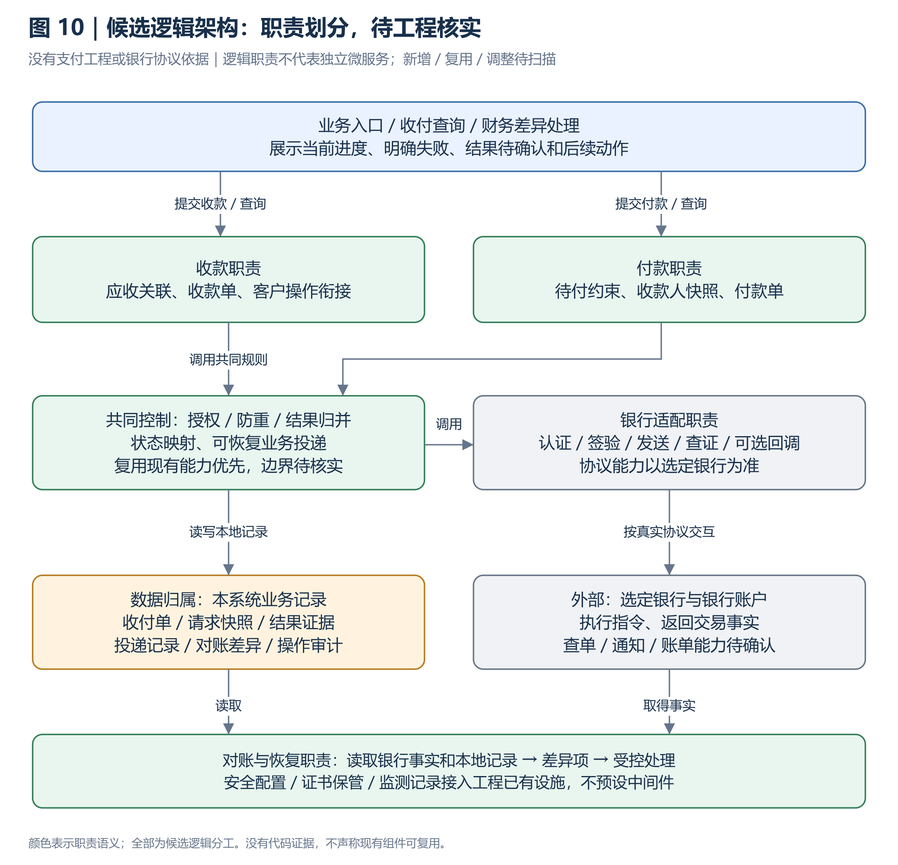

# 银行收付款链路需求图解

版本：V0.1 讨论稿｜日期：2026-11-16｜范围：收款 + 付款。

配套：[关键接口契约](关键接口契约.md) · [开发顺序清单](开发顺序清单.md)。PNG 图可直接阅读；同名 SVG 和 `../assets/bank-payment-example/diagrams/source/` 原生 SVG 可编辑。

## 目标与范围

建立通过银行接口完成收款、付款的业务链路，让业务方能发起、查询并核实每笔结果，出现超时、重复通知或账实差异时仍可追溯。实际业务痛点、交易量和效果目标尚未提供，不预设降本数字或上线日期。

**已确认**：C01 调用银行接口；C02 同时包含收款和付款；C03 交付 Markdown。其余流程、规则与架构均为**建议方案，待评审确认**，不是银行已支持或系统已实现的能力。尚未提供支付工程与银行接口文档；不推断工作区其他项目可复用。

建议讨论范围：两条正向链路、结果查证、防重、权限、对账与异常追溯。退款、主动撤销、自动退回款处理、批量支付、分账、跨境换汇及内部钱包均未确认，不作为本期可用功能。银行实际发生的退回或冲正仍须留存证据并发现差异。

## 一、业务流程：先分清谁把钱付给谁

### 收款：客户付款，业务确认应收是否被有效满足

- 客户付款方式可能是银行收银台、转账认领或其他产品，Q02 未定前不画成“平台直接扣客户银行卡”。
- 业务生效依赖银行可信终态及金额匹配；页面跳转成功只能说明客户完成页面动作。
- 银行可用的查证途径须在接入前明确；回调能力未确认，不能把回调作为唯一保障。

### 付款：企业出款，业务确认待付义务是否被有效满足

- 企业出款账户和收款人账户属于不同角色，发起时保存快照，不能在请求发出后偷偷换账户。
- 审批、额度、占用或冻结尚未确认；图中只保留必要业务校验，不新增确定的审批链。
- “银行已受理”不允许展示成“收款人已到账”。成功含义必须按 Q07 的产品定义映射。

## 二、数据流转：申请不等于资金事实

### 收款数据：业务应收、收款申请、银行事实分开保存

- 本地单标识串起业务与请求，银行交易标识串起银行结果；关系键须随真实协议落实。
- 申请金额、银行交易金额、手续费、实际入账金额分别表达；没有返回的数据不能记为零。
- 一笔应收是否允许分次收款或多次尝试见 Q04；本图不预设拆单能力。

### 付款数据：待付范围约束本地发起，银行事实说明是否执行

- 防重同时覆盖“重复请求”和“同一待付义务被不同请求并发付款”，只按按钮防连点不够。
- 在途范围是业务约束建议，不代表平台持有银行资金或已完成账户冻结。
- 付款成功后的退回保留为关联事实；不能用改写原结果的方法抹去曾经出款的证据。

## 三、关键时序：外部调用失败后仍能找回原请求

### 收款提交：先保存意图，再发送银行请求

- 本地提交与银行执行是两件事；不能用一个本地事务保证银行原子执行。
- 保存后发送前宕机、发送后保存结果前宕机，都要能定位原请求。恢复时先查证，重放须有银行明确保证。

### 付款提交：并发下也只能在待付范围内执行

- 同一业务请求标识、相同内容返回原单；同标识但金额或账户不同必须拒绝。
- 不同请求标识也不能绕过同一待付义务的约束。结果待确认时，不得自动释放在途范围并另付一笔。

### 共享恢复：重复结果不重复生效，业务通知失败可恢复

- 回调先验证真实性和交易归属，持久化成功后才按银行协议确认收到；重复通知返回既有处理结果。
- 结果落库和业务生效跨系统时，需要可恢复投递及业务侧防重；同库可合并提交，无需预设消息队列。
- 查无记录、乱序或相反终态都不能直接触发新付款；保留证据并按银行规则继续查证或转核验。

### 状态与资金含义：支付结果和对账结论分开

- 建议本地语义为待提交、处理中、结果待确认、成功、失败，银行原状态和原始证据同时保留。
- 明确的同步终态可从待提交直接归并到成功或失败；图示展示主要迁移，未说明的银行状态一律待映射。
- 成功后收到旧处理中通知不回退状态；出现互相矛盾的终态则核验，不按最后一条消息覆盖。

### 对账：按交易核对，差异有负责人和处理证据

- 对账依赖银行实际提供的账单、流水或替代证据；账期、时区和截止时间见 Q08。
- 不自动用付款抵扣收款；按账户、方向和币种分别比较，手续费及退回另保留口径。
- 人工处理可以记录核验结论，不能绕过证据直接把支付单改成功。

## 四、候选逻辑架构与工程改动

逻辑职责不等于拆微服务。优先核实并复用工程已有认证、订单、任务调度、审计与通知能力；没有代码证据时无法判断新增、调整或复用。建议改动聚焦四处：收款关联应收，付款约束待付，共同适配银行协议，共同核验结果与恢复业务生效。

查询与修改遵循用户工程规则：SQL 最多关联两张表；可在代码聚合，但避免逐条查询造成额外 IO。候选访问路径围绕业务归属、请求标识、银行交易标识、状态和更新时间；真实索引需由实际结构、执行计划及扫描量核实，本文不声称已走索引。字段、方法与关键资金数据流需注释，代码使用规范换行；只补关键生产链路，验证聚焦高风险边界。

## 五、影响落地的关键决策

| 决策 | 推荐讨论方向 | 未确认时影响 |
| --- | --- | --- |
| 银行与支付产品 | 先确认银行能提供的发起、查证、状态与账单能力 | 接口参数、认证、成功映射与故障恢复不能冻结 |
| 收款方式与账户归属 | 明确谁付款、钱进哪个法律主体账户、客户如何授权 | 收款主链和前端交互不能定案 |
| 正向成功与逆向事实 | 收付正向独立；退款、撤销、退回各有定义再纳入 | 不承诺本期逆向功能 |
| 并发与未知结果 | 推荐同业务范围防重；未知先查证再决定恢复 | 不能把超时重发视为安全操作 |

## 附录 A：建议业务规则

以下 R 编号均为建议验收基线，需业务、研发与银行协议共同确认；跨文档引用同一编号，不代表已审批或已实现。

| 编号 | 规则与边界 |
| --- | --- |
| R01 主体与权限 | 从可信登录／服务身份解析业务数据范围；校验业务单、银行配置和账户归属。客户端传入主体标识不能自行扩大权限。权限模型待 Q05 确认。 |
| R02 金额与快照 | 发起额须大于零并符合选定币种精度；由业务侧计算／校验。币种、申请额、交易额、手续费、实际入账／出账额分别保留；精确数值处理，不用二进制浮点运算金额。快照发出后不可变；变更需走新请求且先确认旧请求结论。 |
| R03 两层防重 | 业务请求按主体、收付方向、业务请求标识防重；同键异参拒绝。银行请求标识稳定并关联本地单；银行交易不可重复归属。对同一业务义务的不同请求还须串行或条件校验，防止并发超收／超付；分次与重试边界由 Q04 确认。 |
| R04 状态权威 | 银行支付终态须通过真实协议映射，受理／处理中／未知均不当成功。验证来源、账户、交易关联、金额和币种后归并；保留银行原状态、发生时间和本地接收时间。 |
| R05 超时与恢复 | 超时表示本系统不知道结果，不代表银行失败。查原请求；查无记录是否可重发、重放窗口及幂等保障按 Q01／Q04 决定。没有保障时进入人工核验，禁止新标识盲发或自动切行。 |
| R06 结果一次生效 | 重复回调、查单、重试投递可出现多次，业务影响只一次。旧处理中不覆盖已确认终态；相反终态或金额不符转差异。回调持久化失败时不确认已处理，回应形式按协议。 |
| R07 付款并发 | 发起不能超过同一义务的可付范围；计算需区分已成功与在途申请。未知结果的在途不因超时自动解除。是否存在本地余额、审批、额度、冻结及释放规则均由 Q05 决定。 |
| R08 资金与逆向 | 收款成功、银行入账、结算可用；付款受理、出款成功、受益人到账分别定义。不得跨账户、方向或币种直接净额混算。后续退回／冲正保留独立事实并核验影响；不等同主动退款已实现。 |
| R09 对账与人工 | 按明确账期和完整数据核对交易关联、方向、账户、金额、币种；手续费与净额按产品定义。获取失败、尚未就绪、空账单分别呈现。差异处理留操作者、依据、前后值；不得无证据改支付成功。 |
| R10 安全与审计 | 认证、传输保护、签验／防重放按银行协议；证书密钥不出现在前端、普通日志或需求样例中。账户信息按角色脱敏；完整原始报文按最小范围受控保存，留存期限待 Q10。 |
| R11 可用性与告知 | 查询展示最后可信状态及时间；读取失败不伪装零金额或失败终态。恢复任务、通知、对账均留进度和失败原因；重试频率、上限与处理时限待 Q10，不能无限重试。 |

## 附录 B：待确认问题及阻塞范围

| 编号 | 要确认什么 | 影响／待确认前可做什么 |
| --- | --- | --- |
| Q01 | 银行、地区、具体收款／付款产品、正式接口版本、沙箱、准入与开户主体？支持哪些发起、查单、通知、账单能力？ | 阻塞银行真实适配、认证配置和联调；可先梳理工程能力及需求模型。 |
| Q02 | 收款是收银台、授权扣款还是转账认领？付款是企业转账还是其他产品？付款人与最终收款主体分别是谁？客户授权在哪里完成？ | 阻塞收款前端、授权与业务归属；转账认领若选用需另展开匹配／认领链路，不能直接套用发起收款图。 |
| Q03 | 币种、精度、单笔／日限额、手续费由谁承担？申请额、实扣额、实收额关系及舍入规则？ | 阻塞金额校验、费用展示和对账计算；不预设人民币或两位精度。 |
| Q04 | 一笔业务能否部分／多次收付？失败后是否允许再发起？银行幂等范围、有效期、查无记录等待窗口及安全重放规则？ | 阻塞分次、重试、关闭与恢复策略；可先确定两层防重要求。 |
| Q05 | 哪些角色能发起／查单／核验？是否审批、复核、额度控制或内部余额？在途如何约束、何时解除？ | 阻塞权限定案及资金控制实现；不默认审批或冻结已存在。 |
| Q06 | 退款、取消、撤销、批量、分账是否本期范围？银行退回／冲正的识别和业务处理责任？ | 阻塞逆向功能；正向设计可继续。无确认时仅保留识别与人工核验，不开放主动逆向按钮。 |
| Q07 | 各产品何种结果表示成功？是否代表扣账、入账、受益人到账或仅处理中？何种证据优先，矛盾终态怎样确认？ | 阻塞状态映射、客户文案、业务生效及验收。 |
| Q08 | 账单来源、账期／时区／节假日、完整性信号、补单／更正版如何处理？差异由谁、多久处理？ | 阻塞生产对账与差异闭环；可先列出差异类型和留痕要求。 |
| Q09 | 支付相关仓库、现有订单／财务模块、数据库归属、既有适配／调度／通知／监测实现？ | 阻塞工程级接口、文件清单及新增／复用判断；本文仅为候选逻辑架构。 |
| Q10 | 峰值规模、超时与查询 SLA、重试窗口、未明结果处理时限、留存期限、值守责任与上线验收目标？ | 阻塞性能与生产参数、留存和运维交接；不承诺具体 TPS、秒数或工期。 |

## 附录 C：高风险验收场景（待执行）

样例金额用 **100 个已选定币种单位**，仅用于验收构造；精度、手续费及到账语义需先确认。以下是验收设计，尚未调用银行或验证实现。

| 编号 | 前置与操作 | 可观察结果 |
| --- | --- | --- |
| A01 正常收款 | 应收 100、权限及账户有效；银行给出经 Q07 映射的匹配成功终态 | 一笔有效收款、一次业务生效；能追到本地单、请求及银行证据。 |
| A02 正常付款 | 待付 100；银行最终确认本次付款成功 | 付款业务只减少一次待付 100；到账文案符合 Q07，不额外承诺到账时间。 |
| A03 重复与异参 | 同请求标识重复提交相同内容，再改金额或收款账户重提 | 相同内容返回原单；异参拒绝；无额外银行资金指令。 |
| A04 并发不同请求 | 同一待付义务仅可付 100，同时用不同请求各申请 100 | 不能形成可执行的超额 200；拒绝或受控等待有明确结果；过程可追溯。 |
| A05 银行成功但响应超时 | 银行执行成功，断开返回连接；随后查得原交易 | 本地先待确认，再归并成功；未产生新交易；未因超时显示明确失败。 |
| A06 回调与查单竞争 | 成功通知重复到达并与查单并发，随后到达旧处理中通知 | 一次生效，状态不倒退，重复证据可查。银行不支持通知时只验查证竞争分支。 |
| A07 矛盾或不符证据 | 提供真实来源但金额／币种不匹配，或同交易相反终态 | 不自动生效或覆盖；生成差异核验项并保留全部相关证据。 |
| A08 本地宕机窗口 | 分别在保存意图后发送前、发送后保存响应前中断进程再恢复 | 找回原单和请求；先查证，只有银行保证允许时按原标识重放，无盲目新发。 |
| A09 业务结果补发 | 银行成功已落库，业务通知超时或业务已应用但确认丢失 | 原结果可恢复投递；业务侧只应用一次，最终能查看投递结论。 |
| A10 权限与真实性 | 越权账户发起／查单；伪造结果通知或篡改交易关联 | 无银行资金指令或数据泄露；伪造证据不更新结果；审计不泄露敏感信息。 |
| A11 银行明确失败 | 银行最终拒绝原付款，且有可关联证据 | 保留失败依据；按确认规则解除在途约束；不自动新建付款。 |
| A12 对账和退回 | 构造本地缺单、银行缺单、重复批次、费用差、后续退回及账单获取失败 | 独立差异可追溯，重跑不重复生效；获取失败不当零交易；退回保留原成功。 |

## 资料与验证边界

业务依据仅为本次对话：调用银行接口、同时覆盖收款和付款。用户尚未指定银行或提供支付工程。图示与文档已做静态一致性、相对链接及渲染检查；未进行银行接口联调、资金操作、数据库执行计划或性能验证。

参考资料仅用于说明“不同银行产品的受理与最终结果可能不同”，不代替选定银行协议：汇丰官方将即时结算与即时受理产品分开描述，后者需要进一步查询处理状态。[HSBC Treasury – Payment Initiation](https://develop.hsbc.com/api-overview/treasury-payment-initiation)（查阅：2026-11-16）。本文据此建议单独核实成功语义，不将该银行的能力、路径或状态码套入本项目。
